# Rule the Isle — Especificação de Design
## Confirmação de Construção Estilo Catan Universe, Alto Contraste de Peças e Enquadramento Padrão do Tabuleiro

**Data:** 2026-11-13  
**Status:** Aprovado pelo Usuário (Opção A)  
**Branch alvo:** `main`  
**Escopo deste documento:**
1. **Confirmação Obrigatória em 2 Etapas (Estilo Catan Universe):** Seleção de aresta/vértice com peça fantasma provisória no tabuleiro + botão grande de confirmação verde `[✔]` e cancelamento `[✕]`.
2. **Novo Modelo e Alto Contraste de Peças (Aldeias, Cidades e Estradas):** Aumento de escala (+25%), contornos nítidos de alto contraste, cores primárias saturadas e silhuetas icônicas limpas que saltam sobre qualquer bioma.
3. **Enquadramento Seguro do Tabuleiro no Início da Partida ("Safe-Area All-in-View"):** Calibração de `computeDefaultSize`, área segura descontando HUD superior e inferior (~230px) e `numLevels = 8.3` para garantir que todos os 19 hexes e os 9 portos com seus navios fiquem 100% visíveis sem corte.

---

## 1. Diagnóstico dos Problemas Relatados

1. **Jogada Irreversível com Clique Único (`ZoomableBoard.tsx`):**
   - A confirmação de posicionamento vinha desativada por padrão (`loadSavedConfirmPlacement() === false`), fazendo com que o primeiro clique em uma aresta ou vértice enviasse a ação imediatamente para a API sem possibilidade de rever ou cancelar.
   - Mesmo quando ativada, a confirmação só mostrava uma pílula central sutil com o ponto de pulso e não desenhava a peça no tabuleiro, gerando incerteza sobre o que seria construído.
   - No Catan Universe (Print 1), ao selecionar onde construir, a peça provisória é exibida no local e um botão verde proeminente com ícone de confirmação `[✔]` surge no lado direito da tela.

2. **Baixa Visibilidade e Contraste das Peças (`GameIcons.tsx`, `Board.scss`, `Node.tsx`, `Edge.tsx`):**
   - As peças de Aldeia e Cidade em `GameIcons.tsx` possuíam traços finos, bases de pedra/madeira escura e sombras profundas (`#190E08`, `#473120`) que, na escala real do tabuleiro, transformavam a peça numa mancha escura.
   - Sobre hexes escuros (Floresta verde-escura, Minério azul-escuro, Tijolo marrom-avermelhado), a cor do jogador (Vermelho, Azul, Laranja, Branco) ficava apagada e difícil de distinguir de relance.
   - As estradas eram barras estreitas (14-16px) com pouca espessura e acabamento que se confundia com as bordas das ilustrações.

3. **Corte Vertical do Tabuleiro e dos Portos ao Iniciar Partida (`Board.tsx`, Print 2):**
   - `computeDefaultSize` utilizava 100% da altura da janela (`containerHeight`), sem deduzir a área física ocupada pela TopBar flutuante (~105px) e pelo console de cartas/ações (~125px).
   - O multiplicador `numLevels = 7.0` cobria apenas os hexes centrais de terra, empurrando os 9 navios costeiros dos portos e suas placas de madeira (2:1 e 3:1) para fora da área visível ou para trás dos elementos da interface.

---

## 2. Arquitetura da Solução

```mermaid
flowchart TD
    subgraph UI_Interaction["Fluxo de Construção com Confirmação"]
        ClickAction["Clique em Vértice ou Aresta Válida"] --> GhostPreview["Renderiza Peça Fantasma + Pulsação Dourada"]
        GhostPreview --> ConfirmPrompt["Ativa Botão Catan Universe [✔] na Tela"]
        ConfirmPrompt --> UserChoice{"Ação do Jogador"}
        UserChoice -->|"Clica no [✔] ou 2º clique na peça"| Commit["Executa postAction() na API"]
        UserChoice -->|"Clica em [✕] ou em outro ponto"| Cancel["Cancela Seleção sem Gasto"]
    end

    subgraph Visual_Enhancement["Modelagem de Alto Contraste"]
        ScaleBoost["Escala +25% nas Aldeias, Cidades e Estradas"]
        Contour["Contorno Duplo Nítido (Tabletop Silhouette)"]
        VibrantColors["Cores Primárias Saturadas (Vermelho, Azul, Laranja, Marfim)"]
        ScaleBoost --> RenderPieces["Peças Nítidas sobre Qualquer Bioma"]
        Contour --> RenderPieces
        VibrantColors --> RenderPieces
    end

    subgraph Sizing_Framing["Enquadramento Safe-Area All-in-View"]
        ScreenHeight["Altura Total da Janela"] --> Deduction["Deduz TopBar (105px) + BottomConsole (125px)"]
        Deduction --> SafeHeight["Altura Efetiva de Oceano Livre"]
        SafeHeight --> NumLevelsCalib["numLevels = 8.3 (Garante Todos os 9 Portos)"]
        NumLevelsCalib --> PerfectFit["Tabulerio 100% Visível sem Cortes no Start"]
    end
```



---

## 3. Especificação Detalhada por Componente

### 3.1. Confirmação de Construção e UI Estilo Catan Universe (`ZoomableBoard.tsx`, `Board.scss`)
- **Padrão Ativado:** `loadSavedConfirmPlacement()` passa a retornar `true` por padrão (caso não exista valor salvo no `localStorage`).
- **Peça Fantasma ("Provisional Ghost Piece"):**
  - Quando `pendingPlacement` estiver ativo:
    - Passa `pendingNodeId`, `pendingNodeType` ("SETTLEMENT" ou "CITY") e `pendingColor` para o `Board` e `Node`.
    - Passa `pendingEdgeId` e `pendingColor` para o `Board` e `Edge`.
    - No `Node.tsx` e `Edge.tsx`, a peça é desenhada no local com opacidade de 88%, borda dourada pulsante e efeito de "encaixe prévio".
- **Botão Catan Universe `[✔]` na Tela:**
  - Botão flutuante na margem direita (ou adjacente à câmera/ações), proeminente, com formato arredondado de alto impacto visual, gradiente esmeralda (`#10b981` a `#059669`), borda luminosa e ícone grande de checkmark `CheckIcon`.
  - Ao lado, botão circular de cancelamento `[✕]` (`CloseIcon`) com tom âmbar/cinza escuro.
  - O jogador pode confirmar clicando no botão `[✔]` OU clicando uma segunda vez na própria peça provisória.

### 3.2. Redesenho de Alto Contraste das Peças (`GameIcons.tsx`, `Board.scss`)
- **Aldeia (`SettlementSvgPiece`):**
  - Aumentar o viewBox e escala em +25% (de `size * 0.64` para `size * 0.80`).
  - Silhueta de casa com telhado de 2 águas triangular bem definido, chaminé contrastante e porta em arco.
  - Contorno externo de 2px de alto contraste com cantos arredondados (`strokeLinejoin="round"`).
  - Preenchimento vibrante: a cor principal do jogador preenche 70% da área visível da peça (paredes e telhado com iluminação frontal clara).
- **Cidade (`CitySvgPiece`):**
  - Aumentar o viewBox e escala em +25% (de `size * 0.72` para `size * 0.90`).
  - Silhueta imponente de castelo/fortaleza com duas torres, ameias (crenellations) e estandarte/bandeira no topo.
  - Alto contraste em relação a todos os biomas.
- **Estrada (`RoadSvgPiece`, `Edge.tsx`, `Board.scss`):**
  - Aumentar a espessura da estrada de 15px para 20-22px (desktop) e 16-18px (mobile).
  - Viga chanfrada com topo iluminado e borda escura nítida para delimitação perfeita mesmo sobre colinas de tijolo ou pastos verdes.

### 3.3. Enquadramento Seguro do Tabuleiro ("Safe-Area All-in-View") (`Board.tsx`)
- **Cálculo da Altura Útil:**
  ```ts
  const TOP_HUD_CLEARANCE = 105;
  const BOTTOM_CONSOLE_CLEARANCE = 125;
  const TOTAL_VERTICAL_CLEARANCE = isCompactHeight ? 120 : isMobile ? 180 : 230;
  const safeHeight = Math.max(260, canvasHeight - TOTAL_VERTICAL_CLEARANCE);
  ```
- **Calibração de Níveis (`numLevels`):**
  - Ajustado de `7.0` para `8.3`. Isso garante que o raio externo dos 9 portos com seus navios e placas de madeira flutuantes (2:1 e 3:1) fiquem 100% contidos na tela com margem de segurança de mar uniforme.
- **Centralização Geométrica:**
  ```ts
  const center: [number, number] = [
    canvasWidth / 2,
    (TOP_HUD_CLEARANCE + (canvasHeight - BOTTOM_CONSOLE_CLEARANCE)) / 2,
  ];
  ```
  Isso posiciona o centro do tabuleiro perfeitamente no meio do vão livre entre as duas barras flutuantes.

---

## 4. Plano de Testes e Validação
- **Testes Unitários:**
  - Atualizar testes de `ZoomableBoard.test.tsx` para verificar o fluxo de confirmação padrão ativo e exibição dos botões `[✔]` e `[✕]`.
  - Atualizar testes de `Board.test.tsx` para garantir que `computeDefaultSize` respeita as margens e dimensões seguras.
- **Testes de Regressão Visual e Responsividade:**
  - Verificar em 1080p, 1366x768 (laptop) e mobile (viewport estreita) que nenhum porto fica cortado.
  - Verificar a visibilidade de todas as 4 cores de jogadores sobre todos os 5 biomas de terreno.
- **Validação de Build:**
  - `npx vitest run Board.test.tsx ZoomableBoard.test.tsx GameScreen.test.tsx`
  - `npx tsc --noEmit`
  - `npm run build`
