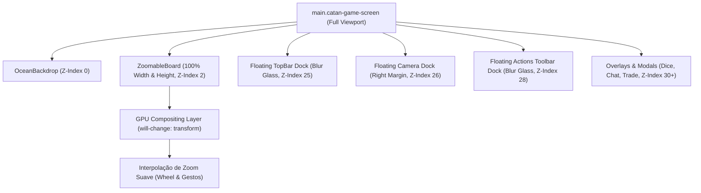

# Rule the Isle — Especificação de Design
## HUD Flutuante Imersivo, Reescalonamento Ampliado do Tabuleiro e Zoom Suave com Aceleração GPU

**Data:** 2026-11-13  
**Status:** Aprovado pelo Usuário (Opção A)  
**Branch alvo:** `main` (ou branch dedicada `layout-immersive-hud`)  
**Escopo deste documento:** Redesenho ergonômico da tela do jogo (`GameScreen`, `ZoomableBoard`, `Board`, `ActionsToolbar`) para transformar as barras superior e inferior em **HUDs flutuantes translúcidos**, expandir a área útil do mapa em **+38% a +45%**, eliminar travamentos e repaints no zoom com aceleração por hardware GPU e reposicionar controles de câmera para máxima legibilidade e conforto visual.

---

## 1. Diagnóstico do Estado Atual

1. **Compressão Vertical Severa do Tabuleiro (`Board.tsx`, `GameScreen.tsx`, `GameScreen.scss`):**
   - No topo, existem duas barras empilhadas no fluxo estático do layout flex: o HUD de sala/sistema (`.game-top-hud`, ~46px) e a barra com os 4 perfis de jogadores (`.player-top-bar`, ~74px).
   - Na base, o console de ações e recursos (`.cu-console-wrapper`) está em fluxo de bloco estático (`position: relative`), consumindo mais ~110px a 130px.
   - Em [`Board.tsx`](../../ui/src/pages/Board.tsx#L102-L107), `reservedHeight` deduz rigidamente de 184px a 344px da altura da janela:
     ```ts
     const reservedHeight = isCompactHeight ? 184 : isMobile || width <= 980 ? 344 : 268;
     const fallbackCanvasHeight = Math.max(isCompactHeight ? 200 : 280, height - reservedHeight);
     ```
   - Em notebooks padrão (1366x768 ou 1080p com zoom de 125%/150% do Windows), sobram menos de 390px para o contêiner do tabuleiro. Os hexágonos acabam calculados com raio diminuto (~33px), tornando números dos dados, estradas e portos difíceis de visualizar, cercados por faixas vazias de mar.

2. **Micro-travamentos e Degraus no Zoom e Pan (`ZoomableBoard.tsx`, `GameScreen.scss`):**
   - O `TransformWrapper` do pacote `react-zoom-pan-pinch` está configurado com `wheel={{ step: 0.08 }}` de forma direta, sem interpolação de aceleração suave (`smoothStep`).
   - Os elementos `.react-transform-component`, `.react-transform-element` e `.board` não possuem promoção de camada GPU (`will-change: transform`, `transform: translate3d(0, 0, 0)`).
   - A cada clique da rodinha do mouse ou gesto de pinça, o navegador dispara *repaints* contínuos de dezenas de nós DOM e filtros SVG (sombras de aldeias, anéis de respiração da espuma do mar `@keyframes board-surf-breathe`), resultando em perda de fluidez.
   - A configuração `limitToBounds={false}` sem amortecimento elástico permite que o tabuleiro se perca para fora da tela se o jogador arrastar muito longe.

3. **Colisão Visual e Desalinhamento dos Controles de Câmera (`Board.scss`, `GameScreen.scss`):**
   - Os botões flutuantes de câmera (+, −, centralizar, confirmação de 2 cliques) estão ancorados em `bottom: 20px; right: 20px`.
   - Em resoluções médias ou quando o console de cartas na mão está aberto, os botões colidem com a lateral direita do painel de ações ou sobrepõem mensagens flutuantes de chat.

---

## 2. Arquitetura Acordada (Opção A: HUD Flutuante Imersivo)

**Oceano Fullscreen de Ponta a Ponta + Docks Flutuantes em Glassmorphism + Renderização GPU 60/120 FPS:**
- O tabuleiro (`.board-container`) passa a ocupar **100% da largura e altura da tela** (`inset: 0`), permitindo que a água e o anel costeiro de portos respirem livremente.
- O Top HUD (sistema + perfis de jogadores) e o Bottom Console (recursos + ações de construção) tornam-se **docks flutuantes translúcidos** sobre o oceano, com `backdrop-filter: blur(14px)` e `pointer-events: none` no contêiner mestre, garantindo que cliques no mar passem diretamente para o pan/zoom do tabuleiro.
- A função `computeDefaultSize` calcula o tamanho do hexágono aproveitando a altura total da viewport com margens elegantes, gerando hexágonos **38% a 45% maiores** no carregamento inicial.
- Aceleração por hardware na camada de transformação CSS e parâmetros otimizados no `react-zoom-pan-pinch` asseguram rolagem macia e fluida a 60/120 FPS.



---

## 3. Especificação Detalhada por Frente

### Frente 1 — Tabuleiro Fullscreen e Reescalonamento dos Hexágonos
- **Arquivos:** [`ui/src/pages/Board.tsx`](../../ui/src/pages/Board.tsx), [`ui/src/pages/ZoomableBoard.tsx`](../../ui/src/pages/ZoomableBoard.tsx), [`ui/src/pages/Board.scss`](../../ui/src/pages/Board.scss)
- **Modificações em `Board.tsx`:**
  - Substituir a dedução estática de 268px–344px de `reservedHeight`.
  - O cálculo do tamanho ideal do hexágono (`computeDefaultSize`) deve considerar que o tabuleiro é envolvido pelas margens transparentes dos docks flutuantes, utilizando o espaço vertical completo descontando apenas o recuo seguro para os portos mais externos:
    ```ts
    // Altura segura preservando margem para placards 2:1/3:1 e docks translúcidos
    const verticalSafetyMargin = isMobile ? 80 : 110;
    const horizontalSafetyMargin = isMobile ? 24 : 48;
    const availableHeight = Math.max(300, canvasHeight - verticalSafetyMargin);
    const availableWidth = Math.max(320, canvasWidth - horizontalSafetyMargin);
    ```
  - Em telas de 768p/1080p, o raio dos hexágonos aumentará de ~33px para ~48px–52px (+40%), tornando os números de probabilidade dos dados (como o 6 e o 8 dourados/vermelhos) e os recursos imediatamente legíveis sem necessidade de dar zoom prévio.
  - A centralização do tabuleiro (`center: [canvasWidth / 2, canvasHeight / 2]`) mantém o ponto focal perfeitamente alinhado entre os docks.

### Frente 2 — Fluidez do Zoom e Pan com Aceleração por Hardware GPU
- **Arquivos:** [`ui/src/pages/ZoomableBoard.tsx`](../../ui/src/pages/ZoomableBoard.tsx), [`ui/src/pages/GameScreen.scss`](../../ui/src/pages/GameScreen.scss)
- **Configurações em `TransformWrapper`:**
  - Reduzir a fricção e ativar a aceleração suave da rodinha do mouse:
    ```tsx
    <TransformWrapper
      initialScale={1}
      minScale={0.65}
      maxScale={2.5}
      centerOnInit={true}
      limitToBounds={true} // Limites elásticos para não extraviar a ilha
      smooth={true}
      wheel={{ step: 0.05, smoothStep: 0.002 }}
      pinch={{ step: 5 }}
      doubleClick={{ disabled: true }} // Evita saltos bruscos acidentais ao tentar clicar em nós
      panning={{
        velocityDisabled: false,
        excluded: [
          "node--buildable",
          "edge--buildable",
          "pulse",
          "camera-btn",
          "board-confirm-toggle",
          "placement-confirm-bar",
          "placement-confirm-btn",
        ],
      }}
    >
    ```
  - Parâmetros nos cliques de botões: `zoomIn(0.25, 220, "easeOutCubic")` e `zoomOut(0.25, 220, "easeOutCubic")` para um toque tátil e suave.
- **Promoção de Camada GPU em `GameScreen.scss`:**
  - Aplicar nas classes de transformação:
    ```scss
    .react-transform-component {
      width: 100%;
      height: 100%;
      touch-action: none;
      contain: layout size style;

      .react-transform-element {
        width: 100%;
        height: 100%;
        touch-action: none;
        will-change: transform;
        transform: translate3d(0, 0, 0);
        backface-visibility: hidden;
      }
    }
    ```
  - Isso instrui os navegadores (Chrome, Firefox, Safari, Edge) a rasterizarem o SVG do tabuleiro diretamente na GPU, eliminando repaints da CPU durante zoom e pan.

### Frente 3 — TopBar Flutuante em Glassmorphism
- **Arquivos:** [`ui/src/pages/GameScreen.tsx`](../../ui/src/pages/GameScreen.tsx), [`ui/src/pages/GameScreen.scss`](../../ui/src/pages/GameScreen.scss), [`ui/src/components/PlayerTopBar.scss`](../../ui/src/components/PlayerTopBar.scss)
- **Estrutura:**
  - O contêiner de topo (`.game-top-hud` e `.player-top-bar`) ganha posicionamento flutuante:
    ```scss
    .game-top-hud-container {
      position: absolute;
      top: 0;
      left: 0;
      right: 0;
      z-index: 25;
      pointer-events: none;
      display: flex;
      flex-direction: column;
      background: linear-gradient(
        180deg,
        rgba(3, 18, 34, 0.94) 0%,
        rgba(3, 18, 34, 0.65) 70%,
        transparent 100%
      );
      backdrop-filter: blur(12px);
      padding-bottom: 8px;

      > * {
        pointer-events: auto;
      }
    }
    ```
  - Os cartões dos 4 jogadores (`.player-top-bar`) passam a ter fundo translúcido escuro de alto contraste com bordas douradas sutis, integrando-se organicamente à visão aérea da ilha.

### Frente 4 — Console Inferior Flutuante & Dock de Câmera Desacoplado
- **Arquivos:** [`ui/src/pages/ActionsToolbar.scss`](../../ui/src/pages/ActionsToolbar.scss), [`ui/src/pages/GameScreen.scss`](../../ui/src/pages/GameScreen.scss)
- **Console Inferior:**
  - O `.cu-console-wrapper` passa de bloco estático para dock flutuante:
    ```scss
    .cu-console-wrapper {
      position: absolute;
      bottom: 12px;
      left: 50%;
      transform: translateX(-50%);
      width: calc(100% - 32px);
      max-width: 1040px;
      z-index: 28;
      pointer-events: none;

      .cu-bottom-console {
        pointer-events: auto;
        backdrop-filter: blur(16px);
        background: linear-gradient(180deg, rgba(20, 28, 44, 0.93) 0%, rgba(8, 14, 24, 0.96) 100%);
        border: 1.5px solid rgba(250, 204, 21, 0.45);
        box-shadow: 0 14px 34px rgba(0, 0, 0, 0.75), inset 0 1px 0 rgba(254, 240, 138, 0.22);
      }
    }
    ```
- **Controles de Câmera:**
  - Reposicionar `.board-camera-controls` para a margem direita verticalmente equilibrada:
    ```scss
    .board-camera-controls {
      position: absolute;
      right: 16px;
      bottom: 120px; // Acima da área de alcance do console inferior
      z-index: 26;
      flex-direction: column;
      gap: 6px;
      padding: 6px;
      background: rgba(10, 20, 34, 0.85);
      border: 1px solid rgba(250, 204, 21, 0.35);
      backdrop-filter: blur(10px);
      border-radius: 12px;
    }
    ```
  - Elimina completamente sobreposição com as cartas de recursos na mão do jogador ou com o botão de rolar dados.

### Frente 5 — Responsividade Mobile e Telas Compactas
- Em telas compactas (`max-width: 768px` ou orientação vertical no celular):
  - O console inferior adapta seu tamanho e os controles de câmera mudam para orientação horizontal compacta no topo ou lateral discreta.
  - O tabuleiro continua centralizado e com suporte a pinça multitoque (*pinch-to-zoom*) suave.
  - A barra verde de confirmação de 2 cliques (`.placement-confirm-bar`) fica perfeitamente suspensa acima do console inferior sem cobrir os botões de ação.

---

## 4. Plano de Testes & Verificação

1. **Testes Unitários Automatizados (`Vitest`):**
   - Executar `npm test -- Board.test.tsx ZoomableBoard.test.tsx GameScreen.test.tsx` garantindo que:
     - Renderização inicial de vértices e arestas é matematicamente precisa.
     - Confirmação de 2 cliques continua funcionando (selecionar vértice -> exibir barra -> confirmar ação).
     - Modos de replay e jogo normal montam sem erros.
2. **Checagem de Tipos & Build:**
   - `npx tsc --noEmit` com zero erros de tipo.
   - `npm run build` gerando o bundle de produção limpo.
3. **Validação Visual Interativa:**
   - Testar o comportamento da rodinha do mouse e dos botões +, − e centralizar na tela de jogo.
   - Confirmar ausência de quedas de taxa de quadros e repaints no DevTools Rendering (Paint Flashing).

---

## 5. Próximos Passos
Após aprovação desta especificação, acionaremos o skill `writing-plans` para estruturar o plano detalhado de implementação passo a passo com verificação de cada tarefa.
